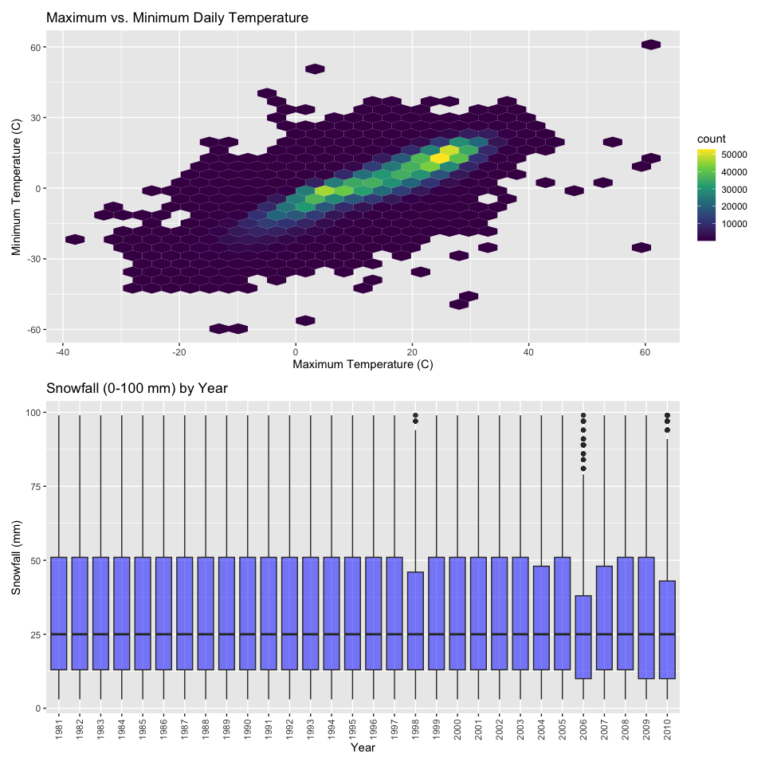
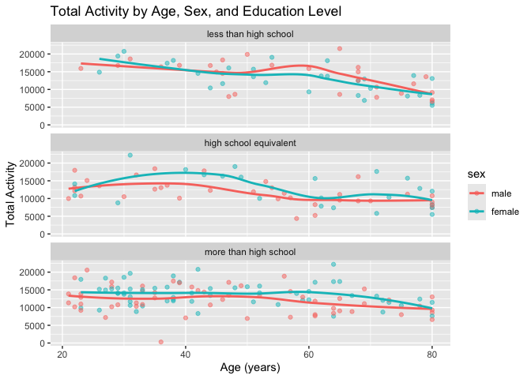

Homework
================
2026-10-18

``` r
library(tidyverse)
```

    ## ── Attaching core tidyverse packages ──────────────────────── tidyverse 2.0.0 ──
    ## ✔ dplyr     1.2.1     ✔ readr     2.2.0
    ## ✔ forcats   1.0.1     ✔ stringr   1.6.0
    ## ✔ ggplot2   4.0.3     ✔ tibble    3.3.1
    ## ✔ lubridate 1.9.5     ✔ tidyr     1.3.2
    ## ✔ purrr     1.2.2     
    ## ── Conflicts ────────────────────────────────────────── tidyverse_conflicts() ──
    ## ✖ dplyr::filter() masks stats::filter()
    ## ✖ dplyr::lag()    masks stats::lag()
    ## ℹ Use the conflicted package (<http://conflicted.r-lib.org/>) to force all conflicts to become errors

``` r
library(p8105.datasets)
library(patchwork)
```

## Setting Options

``` r
knitr::opts_chunk$set(
  fig.width = 6,
  fig.asp = .6,
  out.width = "90%"
)

theme_set(theme_minimal() + theme(legend.position = "bottom"))

options(
  ggplot2.continuous.colour = "viridis",
  ggplot2.continuous.fill = "viridis"
)

scale_colour_discrete = scale_colour_viridis_d
scale_fill_discrete = scale_fill_viridis_d
```

\#Question 1

``` r
data("ny_noaa")
```

``` r
ny_noaa_clean = 
ny_noaa |> 
  separate(date, into = c("year", "month", "day"), sep = "-") |> 
  mutate (
    prcp = (prcp) /10,
    tmax = as.numeric(tmax) /10, 
    tmin = as.numeric(tmin) /10, 
  ) |> 
  rename (
    weather_station_id = id,
    prcp_mm = prcp, 
    snowfall_mm = snow, 
    snow_depth_mm = snwd, 
    prcp_mm = prcp, 
    tmax_c = tmax, 
    tmin_c = tmin 
   )
```

``` r
summary_skimr= 
  skimr::skim(ny_noaa_clean)
summary_skimr
```

|                                                  |               |
|:-------------------------------------------------|:--------------|
| Name                                             | ny_noaa_clean |
| Number of rows                                   | 2595176       |
| Number of columns                                | 9             |
| \_\_\_\_\_\_\_\_\_\_\_\_\_\_\_\_\_\_\_\_\_\_\_   |               |
| Column type frequency:                           |               |
| character                                        | 4             |
| numeric                                          | 5             |
| \_\_\_\_\_\_\_\_\_\_\_\_\_\_\_\_\_\_\_\_\_\_\_\_ |               |
| Group variables                                  | None          |

Data summary

**Variable type: character**

| skim_variable      | n_missing | complete_rate | min | max | empty | n_unique | whitespace |
|:-------------------|----------:|--------------:|----:|----:|------:|---------:|-----------:|
| weather_station_id |         0 |             1 |  11 |  11 |     0 |      747 |          0 |
| year               |         0 |             1 |   4 |   4 |     0 |       30 |          0 |
| month              |         0 |             1 |   2 |   2 |     0 |       12 |          0 |
| day                |         0 |             1 |   2 |   2 |     0 |       31 |          0 |

**Variable type: numeric**

| skim_variable | n_missing | complete_rate | mean | sd | p0 | p25 | p50 | p75 | p100 | hist |
|:---|---:|---:|---:|---:|---:|---:|---:|---:|---:|:---|
| prcp_mm | 145838 | 0.94 | 2.98 | 7.82 | 0.0 | 0.0 | 0.0 | 2.3 | 2286 | ▇▁▁▁▁ |
| snowfall_mm | 381221 | 0.85 | 4.99 | 27.22 | -13.0 | 0.0 | 0.0 | 0.0 | 10160 | ▇▁▁▁▁ |
| snow_depth_mm | 591786 | 0.77 | 37.31 | 113.54 | 0.0 | 0.0 | 0.0 | 0.0 | 9195 | ▇▁▁▁▁ |
| tmax_c | 1134358 | 0.56 | 13.98 | 11.14 | -38.9 | 5.0 | 15.0 | 23.3 | 60 | ▁▂▇▆▁ |
| tmin_c | 1134420 | 0.56 | 3.03 | 10.40 | -59.4 | -3.9 | 3.3 | 11.1 | 60 | ▁▁▇▂▁ |

``` r
nrow(ny_noaa_clean)    
```

    ## [1] 2595176

``` r
ncol(ny_noaa_clean) 
```

    ## [1] 9

``` r
names(ny_noaa_clean)
```

    ## [1] "weather_station_id" "year"               "month"             
    ## [4] "day"                "prcp_mm"            "snowfall_mm"       
    ## [7] "snow_depth_mm"      "tmax_c"             "tmin_c"

The NOAA dataset contains weather data from National Oceanic and
Atmospheric Association (NOAA) in New York. It has 2595176 observations
and 9 with variables weather_station_id, year, month, day, prcp_mm,
snowfall_mm, snow_depth_mm, tmax_c, tmin_c. There is no missing data for
weather station ID, year, month, or day. Missing data is a significant
issue for the other variables: 5.6% of precipitation, 14.7% of snowfall,
22.8% of snow depth, 43.7% of maximum temperature, and 43.7% of minimum
temperature values are missing.

``` r
ny_noaa_clean |>
   mutate(
    month = as.numeric(month),
    year = as.numeric(year)
  ) |>
  filter(month == 1 | month == 7) |>
   mutate(month = factor(month, levels = c(1, 7), labels = c("January", "July"))) |>
  group_by(weather_station_id, year, month) |>
  summarize(mean_tmax = mean(tmax_c, na.rm = TRUE), .groups = "drop") |>
  filter(!is.nan(mean_tmax)) |>
  ggplot(aes(x = year, y = mean_tmax, group = weather_station_id, color=month)) +
  geom_line(alpha = 0.3) +
  geom_point(alpha = 0.3, size = 0.8) +
  facet_wrap(~ month, ncol = 1, scales = "free_y") +
  labs(
    title = "Average maximum temperature by station and year in January vs. July",
    x = "Year",
    y = "Average maximum temperature (C)"
  )
```

<!-- -->

Temperature in July across weather stations appears relatively stable,
while in January the temperature across weather stations appears to
fluctuate more as it has more ridges and dips in temperature. Overall
across weather stations the rise and falls of the temperature appear
similar in July and January. Interestingly, there is a notable drop in
temperature in mid January. There are two distinct outliers: one in
early to mid July around 1988 as well as a on outlier in late July
around 2005.

``` r
p1 = ny_noaa_clean |>
  ggplot(aes(x = tmax_c, y = tmin_c)) +
  geom_hex() +
  scale_fill_viridis_c() +
  labs(
    title = "Maximum vs. Minimum Daily Temperature",
    x = "Maximum Temperature (C)",
    y = "Minimum Temperature (C)"
  )
p2 = ny_noaa_clean |>
  filter(snowfall_mm > 0, snowfall_mm < 100) |>
  ggplot(aes(x = year, y = snowfall_mm)) +
  geom_boxplot(fill = "blue", alpha = 0.5) +
  labs(
    title = "Snowfall (0-100 mm) by Year",
    x = "Year",
    y = "Snowfall (mm)"
  ) +
  theme(axis.text.x = element_text(angle = 90, vjust = 0.5))
p1/p2
```

    ## Warning: Removed 1136276 rows containing non-finite outside the scale range
    ## (`stat_binhex()`).

<!-- -->
Because the dataset has over 2 million observations, a scatterplot for
plot 1 would have severe overplotting, so I used geom_hex() instead. It
divides the plot into hexagonal bins and colors each bin by the number
of days that fall inside it, so the full dataset is shown and areas
where observations are concentrated stand out.

\##Question 2

Load Data Sets

``` r
nhanes_covar = read_csv("Data/nhanes_covar.csv",
skip=4)
```

    ## Rows: 250 Columns: 5
    ## ── Column specification ────────────────────────────────────────────────────────
    ## Delimiter: ","
    ## dbl (5): SEQN, sex, age, BMI, education
    ## 
    ## ℹ Use `spec()` to retrieve the full column specification for this data.
    ## ℹ Specify the column types or set `show_col_types = FALSE` to quiet this message.

``` r
nhanes_accel = read_csv("Data/nhanes_accel.csv")
```

    ## Rows: 250 Columns: 1441
    ## ── Column specification ────────────────────────────────────────────────────────
    ## Delimiter: ","
    ## dbl (1441): SEQN, min1, min2, min3, min4, min5, min6, min7, min8, min9, min1...
    ## 
    ## ℹ Use `spec()` to retrieve the full column specification for this data.
    ## ℹ Specify the column types or set `show_col_types = FALSE` to quiet this message.

Clean Data

``` r
nhanes_covar_tidy = nhanes_covar |>
  janitor::clean_names() |>
  filter (age >= 21) |> 
  drop_na(sex, age, bmi, education) |>
  mutate(
    sex = case_match(
      sex,
      1 ~ "male",
      2 ~ "female"
    ),
    sex = factor(sex, levels = c("male", "female")),
    education = case_match(
    education,
      1 ~ "less than high school",
      2 ~ "high school equivalent",
      3 ~ "more than high school"),
     education = factor(
     education,
     levels = c("less than high school",
               "high school equivalent",
               "more than high school"),
    ordered = TRUE
  )
) |>
  rename(education_level = education)
```

    ## Warning: There was 1 warning in `mutate()`.
    ## ℹ In argument: `sex = case_match(sex, 1 ~ "male", 2 ~ "female")`.
    ## Caused by warning:
    ## ! `case_match()` was deprecated in dplyr 1.2.0.
    ## ℹ Please use `recode_values()` instead.

``` r
  nhanes_accel_tidy = nhanes_accel |>
  janitor::clean_names()
```

Join Datasets

``` r
data_prob_2 = inner_join(nhanes_covar_tidy, nhanes_accel_tidy, by = "seqn")
```

Table + visualization

``` r
edu_by_gender = 
data_prob_2 |>
  count(education_level, sex) |>
  pivot_wider(
    names_from = sex,
    values_from = n,
    values_fill = 0
  ) 
```

``` r
edu_by_age_gender = data_prob_2 |>
  ggplot(aes(x = age, fill = sex)) +
  geom_histogram(binwidth = 5, alpha = 0.6, position = "identity") +
  facet_wrap(~ education_level, ncol = 1) +
  labs(
    title = "Age Distribution of Men and Women by Education Level",
    x = "Age (years)",
    y = "Number of participants",
    fill = "Sex"
  )

edu_by_age_gender
```

<!-- -->

In general, there are more women than males that have more than high
school education and high school equivalent and males appear to be
relatively younger in the dataset as well compared to females. Less than
high school education level, appears to be simlarly distributed by age
and gender.

``` r
data_prob_2_tidy = data_prob_2 |>
  mutate(total_activity = rowSums(across(starts_with("min")))) |> 
  select(seqn, sex, age, bmi, education_level, total_activity) |> 


  ggplot(aes(x = age, y = total_activity, color= sex)) +
  geom_point(alpha=0.5) +
  geom_smooth(se = FALSE) +
  facet_wrap(~ education_level, ncol = 1) +
  labs(
    title = "Total Activity by Age, Sex, and Education Level",
    x = "Age (years)",
    y = "Total Activity"
  )

data_prob_2_tidy
```

    ## `geom_smooth()` using method = 'loess' and formula = 'y ~ x'

<!-- --> Based on the
trend lines, total activity appears to have a relatively similar
distribution by age, sex, and education level. Those with less than high
school education level, males have slightly greater total activity.
Those with high school equivalent and more than high school education
level, the trend flips and females have slightly higher total activity
levels.

Plot 24 hour activity by education level and sex

``` r
data_prob_2_long = data_prob_2 |>
  pivot_longer(
    cols = starts_with("min"),
    names_to = "minute",
    names_prefix = "min",
    values_to = "activity"
  ) |>
  mutate(
    minute = as.numeric(minute),
    hour = (minute - 1) / 60
  )

data_prob_2_long |>
 group_by(education_level, sex, hour) |>
  summarize(mean_activity = mean(activity), .groups = "drop") |>
  ggplot(aes(x = hour, y = mean_activity, color = sex)) +
  geom_line(alpha = 0.4) +
  geom_smooth(se = FALSE) +
  facet_wrap(~ education_level, ncol = 1) +
    scale_x_continuous(breaks = seq(0, 24, 6)) +
  labs(
    title = "Average 24-hour Activity by Education Level and Sex",
    x = "Hour of day",
    y = "Mean activity",
    color = "Sex"
  )
```

    ## `geom_smooth()` using method = 'gam' and formula = 'y ~ s(x, bs = "cs")'

<!-- -->
Plotting every participant’s activity made the trends hard to see,
because a few extreme values stretched the y-axis and compressed the
group patterns. Instead, I plotted the mean activity at each minute of
the day for each education level and sex, with a smooth trend overlaid.
This zoomed the plot in on the typical pattern. Across all education
levels and both sexes, activity follows a similar daily shape: it is
lowest overnight, rises in the morning, stays fairly steady through the
day, and declines in the evening. The trend lines for men and women are
close together within each education level, and the education levels
look similar to each other, so there is little visible difference in
total activity stratified by sex or education.

\##Question 3

Load Data Sets

``` r
citi_jan2020 = read_csv("data/citibike/Jan 2020 Citi.csv")
```

    ## Rows: 12420 Columns: 7
    ## ── Column specification ────────────────────────────────────────────────────────
    ## Delimiter: ","
    ## chr (6): ride_id, rideable_type, weekdays, start_station_name, end_station_n...
    ## dbl (1): duration
    ## 
    ## ℹ Use `spec()` to retrieve the full column specification for this data.
    ## ℹ Specify the column types or set `show_col_types = FALSE` to quiet this message.

``` r
citi_jan2024 = read_csv("data/citibike/Jan 2024 Citi.csv")
```

    ## Rows: 18861 Columns: 7
    ## ── Column specification ────────────────────────────────────────────────────────
    ## Delimiter: ","
    ## chr (6): ride_id, rideable_type, weekdays, start_station_name, end_station_n...
    ## dbl (1): duration
    ## 
    ## ℹ Use `spec()` to retrieve the full column specification for this data.
    ## ℹ Specify the column types or set `show_col_types = FALSE` to quiet this message.

``` r
citi_july2020 = read_csv("data/citibike/July 2020 Citi.csv")
```

    ## Rows: 21048 Columns: 7
    ## ── Column specification ────────────────────────────────────────────────────────
    ## Delimiter: ","
    ## chr (6): ride_id, rideable_type, weekdays, start_station_name, end_station_n...
    ## dbl (1): duration
    ## 
    ## ℹ Use `spec()` to retrieve the full column specification for this data.
    ## ℹ Specify the column types or set `show_col_types = FALSE` to quiet this message.

``` r
citi_july2024 = read_csv("data/citibike/July 2024 Citi.csv")
```

    ## Rows: 47156 Columns: 7
    ## ── Column specification ────────────────────────────────────────────────────────
    ## Delimiter: ","
    ## chr (6): ride_id, rideable_type, weekdays, start_station_name, end_station_n...
    ## dbl (1): duration
    ## 
    ## ℹ Use `spec()` to retrieve the full column specification for this data.
    ## ℹ Specify the column types or set `show_col_types = FALSE` to quiet this message.

Tidy Datasets

``` r
citi_jan2020_tidy= 
  citi_jan2020 |> 
    janitor::clean_names()

citi_jan2024_tidy= 
  citi_jan2024 |> 
    janitor::clean_names()

citi_july2020_tidy= 
  citi_july2020 |> 
    janitor::clean_names()

citi_july2024_tidy= 
  citi_july2024 |> 
    janitor::clean_names()
```

Join Datasets

``` r
citi_data = bind_rows(
  citi_jan2020_tidy |> mutate(year = 2020, month = "January"),
  citi_jan2024_tidy |> mutate(year = 2024, month = "January"),
  citi_july2020_tidy |> mutate(year = 2020, month = "July"),
  citi_july2024_tidy |> mutate(year = 2024, month = "July")
)
```

Plot

``` r
citi_data_table=
citi_data |> 
 count(year, month, member_casual) |> 
 pivot_wider(
    names_from = member_casual,
    values_from = n,
    values_fill = 0
  ) |> 
    mutate(ride_totals = casual + member)
citi_data_table
```

    ## # A tibble: 4 × 5
    ##    year month   casual member ride_totals
    ##   <dbl> <chr>    <int>  <int>       <int>
    ## 1  2020 January    984  11436       12420
    ## 2  2020 July      5637  15411       21048
    ## 3  2024 January   2108  16753       18861
    ## 4  2024 July     10894  36262       47156

Based on this table, there were significantly less rides in January and
July 2020 compared to those same months in 2024, which makes sense
because NYC was impacted by COVID-19 and there were stay at home orders
in place. In general, there were more rides in July compared to June in
both 2020 and 2024, likely because the warmer weather encourages people
to spend time outside.

Plot 5 Most Popular Start Stations

``` r
citi_data_table2 =
citi_data |> 
filter (month == "July", year == "2024") |> 
count(start_station_name, name = "ride_totals", sort = TRUE) |>
slice_head(n = 5)

citi_data_table2
```

    ## # A tibble: 5 × 2
    ##   start_station_name       ride_totals
    ##   <chr>                          <int>
    ## 1 Pier 61 at Chelsea Piers         163
    ## 2 University Pl & E 14 St          155
    ## 3 W 21 St & 6 Ave                  152
    ## 4 West St & Chambers St            150
    ## 5 W 31 St & 7 Ave                  146

Affect of Days on the Week on Median Ride Duration

``` r
citi_data_plot = citi_data |>
  group_by(weekdays, month, year) |>
  summarize(median_duration = median(duration, na.rm = TRUE), .groups = "drop") |>
  mutate(
    weekdays = factor(weekdays,
                      levels = c("Monday", "Tuesday", "Wednesday", "Thursday",
                                 "Friday", "Saturday", "Sunday")),
    year = factor(year)
  ) |>
  ggplot(aes(x = weekdays, y = median_duration, color = year, group = year)) +
  geom_line() +
  geom_point() +
  facet_wrap(~ month) +
  scale_x_discrete(labels = c("Mon", "Tue", "Wed", "Thu", "Fri", "Sat", "Sun")) +
  labs(
    title = "Median Ride Duration by Day of Week, Month, and Year",
    x = "Day of Week",
    y = "Median Ride Duration (min)",
    color = "Year"
  )

citi_data_plot
```

<!-- -->

This plot highlights that ride duration are consistently longer in 2020
and similarly rides are longer in July as compared to January. The
longest ride consistent over time were July 2020. This is interesting
because I would have expected ride durations to be longer in 2024 when
there was less restrictions due to COVID-19.

``` r
citi_2024_plot = citi_data |>
  filter(year == 2024) |>
  ggplot(aes(x = month, y = duration, fill = member_casual)) +
  geom_boxplot(outlier.alpha = 0.1) +
  facet_wrap(~ rideable_type) +
  labs(
    title = "Ride Duration by Month, Membership Status, and Bike Type (2024)",
    x = "Month",
    y = "Ride duration (minutes)",
    fill = "Rider Type"
  )
citi_2024_plot
```

<!-- -->
The distribution of ride duration is pretty similar between bike type
(classic and electric), rider type (casual and member), and months
January and July. The ride duration was consistently longer for casual
riders across months and bike type. Similarly, July had longer or about
the same ride durations across months and rider type. Members had a ride
duration distribution that stayed relatively the same across months and
bike type.
